### Escuela Colombiana de Ingeniería
### Arquitecturas de Software - ARSW

# Informe de laboratorio: Escalabilidad serverless con Azure Functions

**Escenario de calidad.** Cuando un conjunto de usuarios consulta un enésimo número de Fibonacci superior a 1.000.000 de forma concurrente y el sistema está en condiciones normales, **todas las peticiones deben responderse y el consumo de CPU no puede superar el 70 %**.

| Función | Código | Enfoque                                          |
|---|---|--------------------------------------------------|
| `Fibonacci` | [`Fibonacci/index.js`](FunctionProject/Fibonacci/index.js) | Iterativo con un ciclo de `n` sumas              |
| `FibonacciMemo` | [`FibonacciMemo/index.js`](FunctionProject/FibonacciMemo/index.js) | Recursivo con memoization en una variable global |

## 1. Crear la Function App

**Paso 1 del lab.**

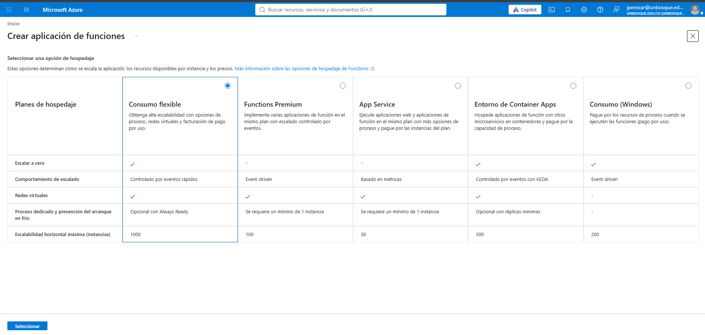

Al crear la aplicación de funciones, Azure pide elegir un plan de hospedaje. Se seleccionó **Consumo flexible**, que en la comparación del portal aparece con escala a cero, redes virtuales, escalado controlado por eventos rápidos y hasta **1000 instancias** como escalabilidad horizontal máxima. Los demás planes (Functions Premium, App Service, Container Apps y Consumo para Windows).

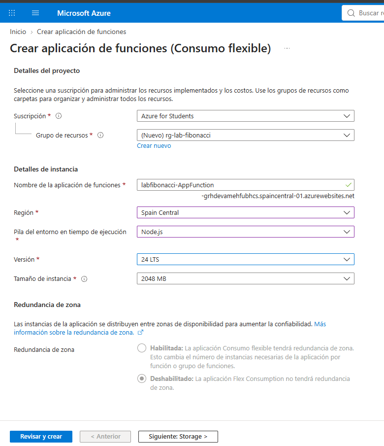

*Datos básicos: suscripción *Azure for Students*, grupo de recursos nuevo `rg-lab-fibonacci`, aplicación `labfibonacci-AppFunction`, región **Spain Central**, pila **Node.js**, versión **24 LTS**, tamaño de instancia **2048 MB** y redundancia de zona deshabilitada.*

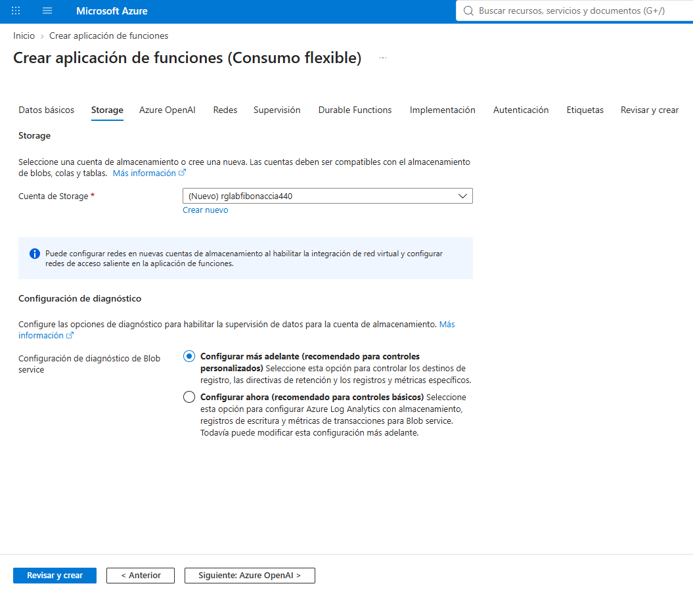

*Pestaña *Storage*: Azure crea una cuenta de almacenamiento nueva, `rglabfibonaccia440`, junto con la aplicación. El diagnóstico del servicio Blob se deja para configurar más adelante.*

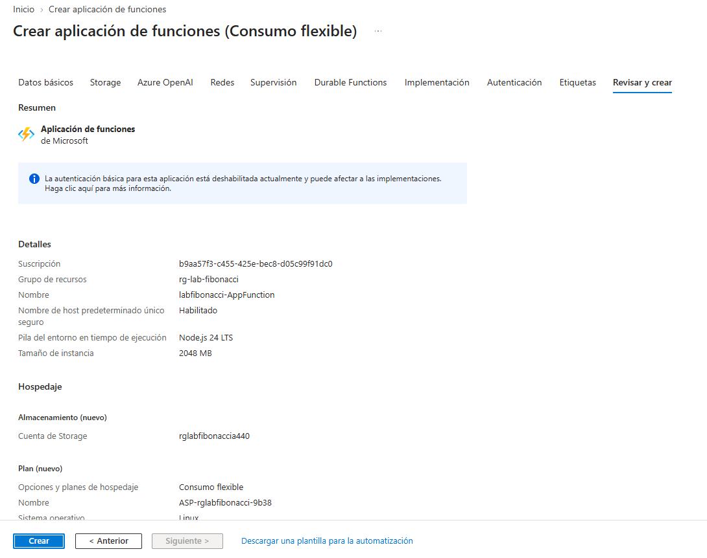

*Resumen antes de crear: Node.js 24 LTS, 2048 MB, cuenta de storage nueva `rglabfibonaccia440` y un plan nuevo `ASP-rglabfibonacci-9b38` de tipo **Consumo flexible** sobre Linux.*

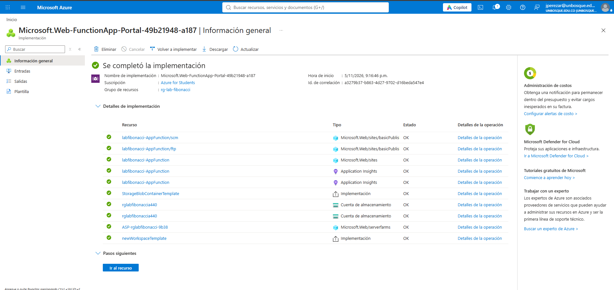

*La implementación `Microsoft.Web-FunctionApp-Portal-49b21948-a187` se completó. Creó, entre otros, el sitio `labfibonacci-AppFunction`, dos recursos de Application Insights, la cuenta de almacenamiento, el plan `ASP-rglabfibonacci-9b38` y el espacio de trabajo de supervisión.*

## 2. Instalar las extensiones en Visual Studio Code

**Paso 2 del lab.**

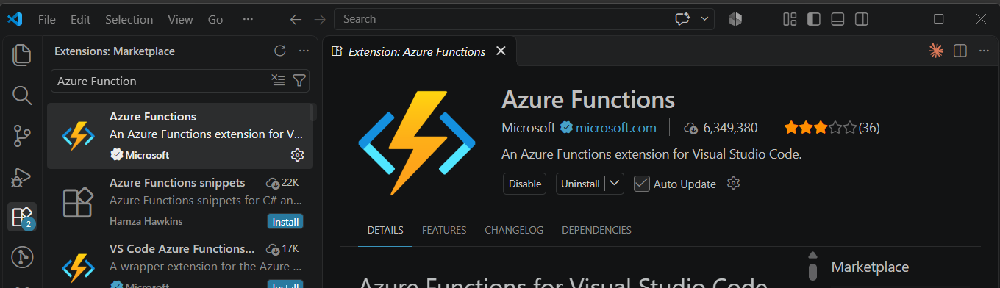

*Extensión **Azure Functions** de Microsoft en el Marketplace de VS Code, ya instalada.*

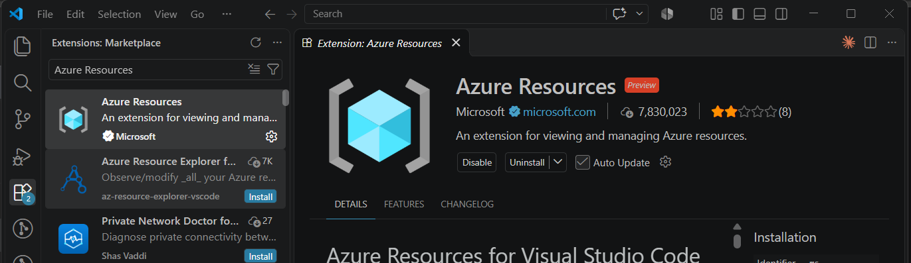

*Extensión **Azure Resources**, que permite ver y administrar los recursos de la suscripción desde el editor.*

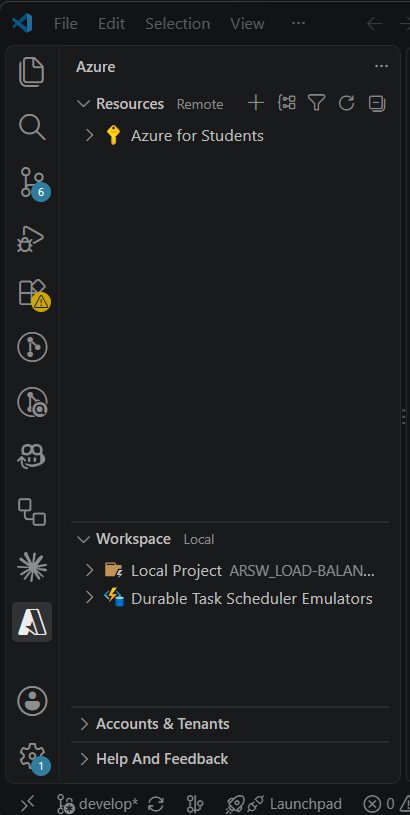

*Con las extensiones instaladas aparece el panel de Azure. En *Resources* se ve la suscripción *Azure for Students*, y en *Workspace* el proyecto local `ARSW_LOAD-BALANCING_Leon_Cristancho`.*

## 3. Desplegar la función desde VS Code

**Paso 3 del lab.**

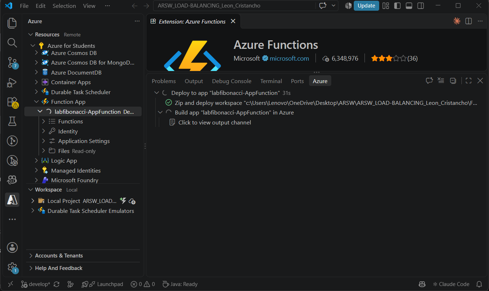

*Despliegue sobre `labfibonacci-AppFunction`: el panel *Azure* muestra *Zip and deploy workspace* completado y *Build app* en curso en Azure. En el árbol, la Function App ya aparece con sus nodos *Functions*, *Identity*, *Application Settings* y *Files*.*

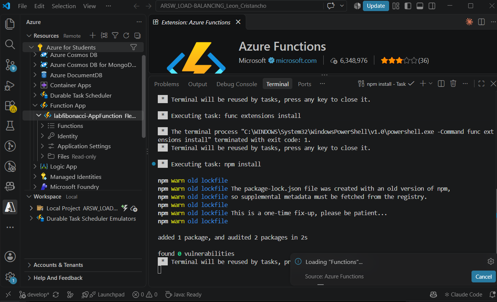

*Salida de las tareas previas al despliegue. `func extensions install` terminó con código de salida 1, y luego `npm install` se ejecutó bien.*

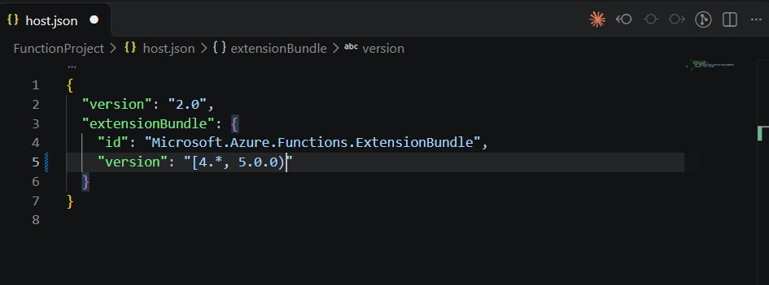

*Ajuste en [`host.json`](FunctionProject/host.json): se fija el rango del *extension bundle* en `"[4.*, 5.0.0)"`.*

## 4. Probar la función en el portal

**Paso 4 del lab.**

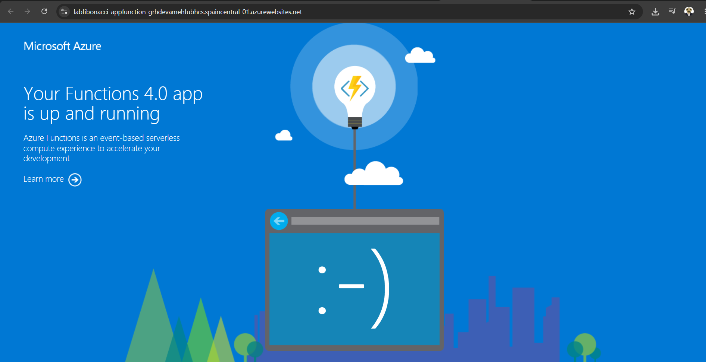

*Al abrir la URL base de la aplicación (`labfibonacci-appfunction-...spaincentral-01.azurewebsites.net`) aparece la página «Your Functions 4.0 app is up and running»: el runtime v4 está activo.*

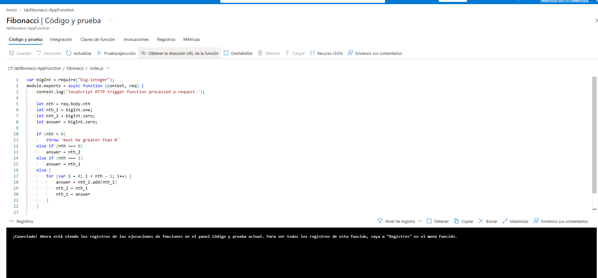

*La función `Fibonacci` ya está desplegada: la vista *Código y prueba* del portal muestra su `index.js`, el mismo del repositorio.*

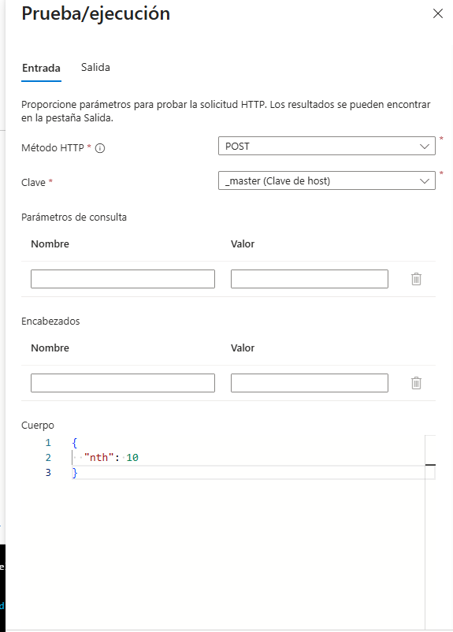

*Panel *Prueba/ejecución*: método **POST**, clave `_master` (clave de host) y cuerpo `{ "nth": 10 }`.*

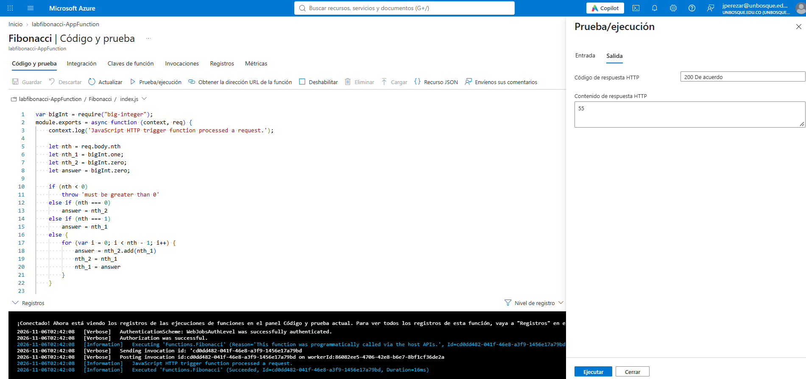

*Resultado: **HTTP 200** con el contenido **`55`**, que es F(10). El registro confirma `Executed 'Functions.Fibonacci' (Succeeded, ... Duration=16ms)`.*

## 5. Pruebas de carga concurrente

**Paso 5 del lab.** El lab sugiere Newman; en este caso las 10 peticiones concurrentes se lanzaron con el script `test.js`, que usa `fetch` de Node.js y dispara 10 peticiones `POST` a la vez contra `/api/Fibonacci`, midiendo el tiempo de cada una.

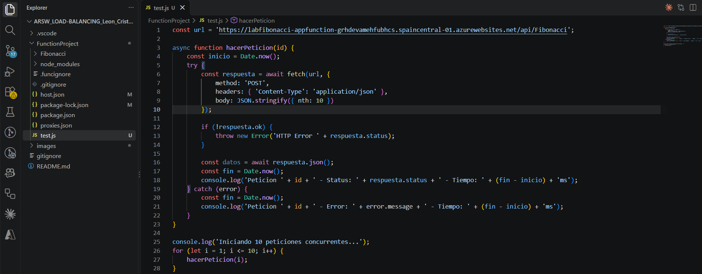

*El script en VS Code: arranca 10 llamadas a `hacerPeticion(i)` sin esperar entre ellas y registra estado HTTP y tiempo. En esta captura el cuerpo de la petición es `{ nth: 10 }`.*

### 5.1 Con n = 10

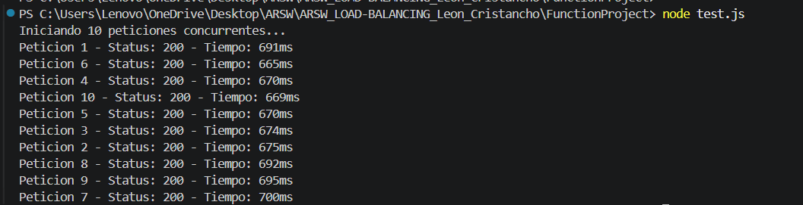

*Ejecución con `node test.js` y `nth: 10`: las 10 peticiones responden **200** en un rango de **665 ms a 700 ms**. Es un tiempo casi constante, dominado por la latencia de red y el procesamiento de la plataforma, no por el cálculo (en el portal la misma función tardó 16 ms).*

### 5.2 Con n = 1.000.000

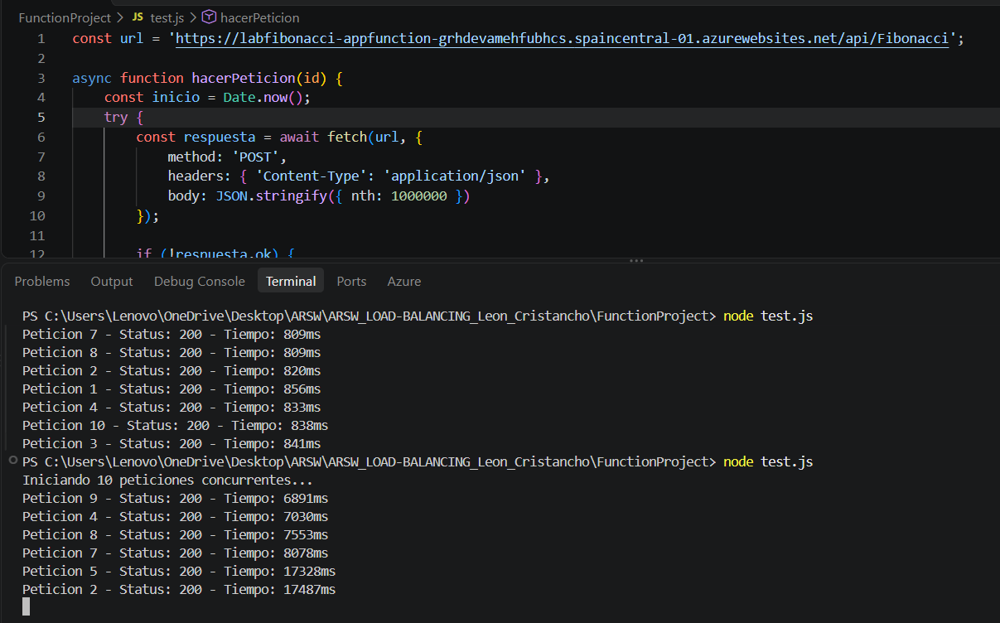

*Se cambia el cuerpo a `nth: 1000000` y se ejecuta de nuevo. En la terminal, el bloque de arriba es una ejecución anterior cuya cabecera quedó fuera de la captura: sus tiempos (809–856 ms) corresponden a un `n` pequeño, porque ninguna petición con n = 1.000.000 baja de ~6,9 s en la corrida siguiente. La corrida de 1.000.000 muestra las respuestas que ya habían llegado cuando se tomó la captura:*

## 6. Función con memoization

**Paso 6 del lab.** Se crea una segunda función, `FibonacciMemo`, con un enfoque recursivo y una tabla `memo` global.

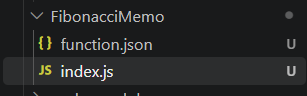

*Carpeta `FibonacciMemo` dentro del proyecto, con su `function.json` y su `index.js`.*

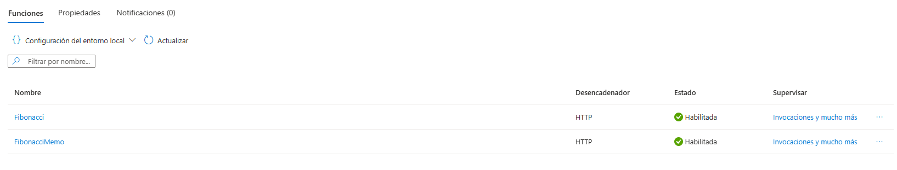

*Tras desplegar, la Function App muestra las dos funciones, **Fibonacci** y **FibonacciMemo**, ambas con desencadenador HTTP y estado *Habilitada*.*

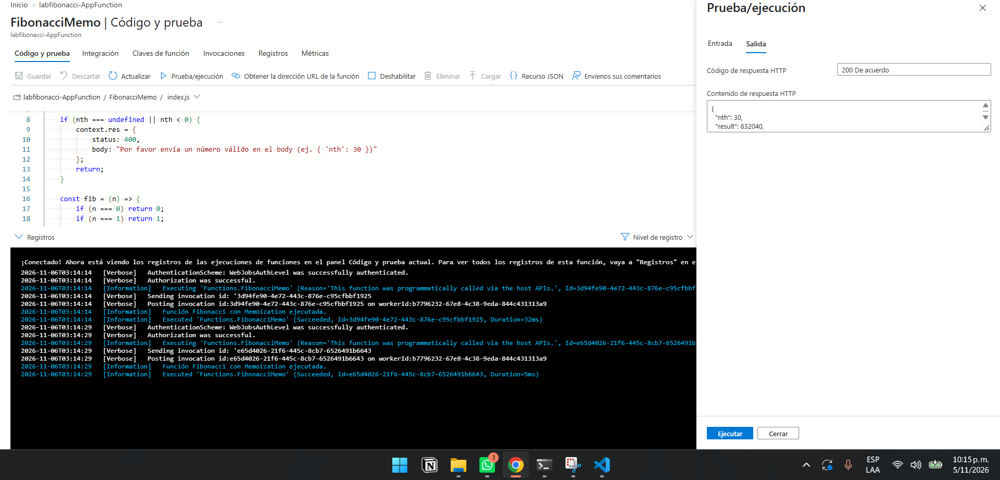

*Prueba de `FibonacciMemo` con `{ "nth": 30 }`: responde **200** con `result: 832040`, que es F(30). En el registro, la misma función se ejecutó dos veces, con 15 segundos de diferencia y en el mismo *worker* (`workerId:b7796232...`):*

| Ejecución | Hora (UTC) | Duración |
|---|---|---|
| 1.ª | 03:14:14 | **32 ms** |
| 2.ª | 03:14:29 | **5 ms** |

*La segunda llamada es mucho más rápida porque `memo` ya tenía los valores calculados en la memoria de esa instancia: es el efecto esperado de la memoization.*

---

## 7. Preguntas del laboratorio

### ¿Qué es una Azure Function?
Es el servicio de cómputo **basado en eventos** de Azure: se escribe una función pequeña que se ejecuta cuando ocurre un *desencadenador* (*trigger*), por ejemplo una petición HTTP, un mensaje en una cola o un temporizador, y puede tener *bindings* de entrada y salida. Aquí se usaron dos funciones con desencadenador HTTP y `function.json` define su `httpTrigger` y su salida `http`.

### ¿Qué es serverless?
Es un modelo en el que el desarrollador no administra servidores: la plataforma aprovisiona, escala (incluso a cero) y parchea la infraestructura, y se paga por el uso, no por máquinas encendidas. Siguen existiendo servidores, pero los gestiona Azure. En este lab, la Function App no requirió crear ni configurar VMs, un balanceador ni reglas de red, a diferencia del laboratorio con máquinas virtuales.

### ¿Qué es el runtime y qué implica seleccionarlo al crear la Function App?
Es el entorno donde corre el código: el **host de Azure Functions**  más la **pila del lenguaje** elegida. Al elegirlo se define qué lenguaje y versión se podrán usar, el sistema operativo (en Consumo flexible, Linux), qué características están disponibles y el soporte de actualizaciones. Todas las funciones de la app comparten esa pila: no se puede mezclar, por ejemplo, Node.js y Python en la misma Function App.

### ¿Por qué es necesario crear un Storage Account junto con una Function App?
Porque el runtime de Functions usa Azure Storage para su funcionamiento interno: guardar los **paquetes de código desplegados**, las **claves** de acceso, coordinar el escalado y los desencadenadores basados en eventos, y llevar el registro del estado (por ejemplo en Durable Functions). En la implementación se ve que se crea la cuenta `rglabfibonaccia440` y una plantilla de contenedor de blobs.

### Planes de una Function App
Los planes que ofrece el portal y sus diferencias principales:

| Plan | Escala a cero | Redes virtuales | Escala horizontal máx. (p1) | Ventajas | Desventajas |
|---|---|---|---|---|---|
| **Consumo flexible** (usado) | Sí | Sí | 1000 | Pago por uso, escalado rápido por eventos, VNet, tamaños de 512, 2048 y 4096 MB, *Always Ready* opcional | Solo Linux, sin contenedores propios, una app por plan |
| **Functions Premium** | No (mín. 1 instancia) | Sí | 100 | Sin arranque en frío (instancias precalentadas), instancias más potentes | Costo más alto y fijo, porque siempre hay una instancia activa |
| **App Service** (dedicado) | No (mín. 1 instancia) | Sí | 30 | Costo predecible, comparte plan con aplicaciones web | Escalado manual o por métricas, no por eventos; se paga la capacidad aunque no se use |
| **Container Apps** | Sí | Sí | 300 | Control total de la imagen del contenedor, GPU | Solo contenedores Linux |
| **Consumo (Windows)** | Sí | No | 200 | Pago por ejecución | Plan heredado, con arranques en frío y sin VNet |

### ¿Por qué la memoization falla o no funciona de forma correcta?
Con las capturas del informe, la memoization **sí funciona** dentro de una misma instancia (32 ms frente a 5 ms). Falla o pierde efecto por varias razones.

1. **El estado vive en la memoria de una instancia, no en la función.** `memo` es una variable global del proceso. Si la plataforma escala a **varias instancias** (cada una con su `memo` vacío) o **reinicia o recicla** la instancia, o la **escala a cero** tras un tiempo sin uso, la caché se pierde y hay que recalcular. En una arquitectura serverless las funciones deben considerarse sin estado; para compartir caché haría falta un servicio externo.
2. **No sirve para valores grandes.** El enfoque recursivo agota la pila de llamadas con `n` del orden de miles, mucho antes de 1.000.000 (se capturaría como error 500), así que no resuelve el caso del escenario de calidad.
3. **Pierde precisión.** Usa `Number` de JavaScript, no `big-integer`: los resultados dejan de ser exactos a partir de F(79) (que supera 2^53) y se vuelven `Infinity` pasando de F(1476). La función `Fibonacci` iterativa sí usa `big-integer`.
4. **No ayuda a la concurrencia.** Las peticiones concurrentes siguen compitiendo por el mismo hilo; la caché solo ayuda con valores ya calculados en esa instancia.

### ¿Cómo funciona el sistema de facturación de las Function App?
Depende del plan. En **Consumo flexible**, el usado aquí, cada instancia se factura en uno de dos modos:
- **Bajo demanda:** se paga la **memoria provisionada (GB-segundo) mientras la instancia ejecuta funciones activamente** y el **número de ejecuciones**, con una concesión gratuita mensual de ambas. No hay costo si no hay ejecuciones. El tiempo mínimo facturable por ejecución es 1.000 ms y luego se redondea a múltiplos de 100 ms.
- ***Always Ready*:** se paga además la memoria base de las instancias que se mantienen siempre listas (sin concesión gratuita), a cambio de evitar el arranque en frío.

---
